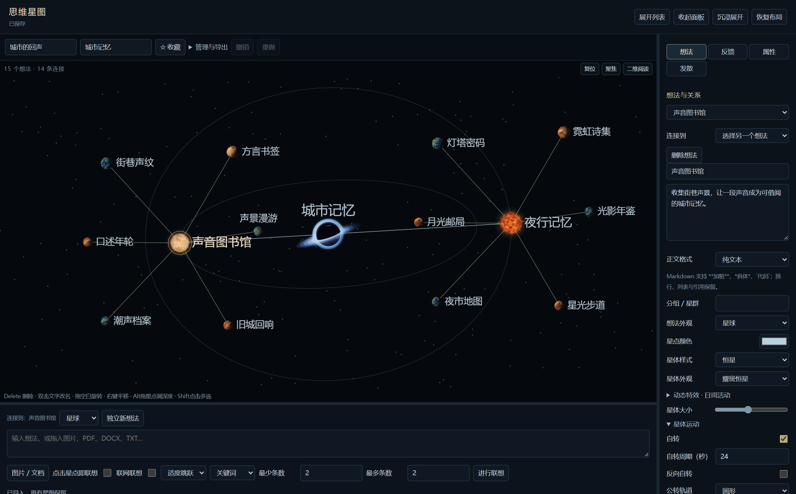

# 思维星图 · Idea Asterism

思维星图是 DeepSeek Harness（DSH）的三维头脑风暴插件。写下一句话，放进一张照片，或拖入一份文档，就能从这份素材向外联想。你可以沿一颗星追问，也可以在同一片星空里另起一个想法，等两条线索碰到一起时，再亲手把它们连起来。

Idea Asterism is a 3D brainstorming plugin for DeepSeek Harness. Turn notes, images, and documents into a star map. Follow an AI-generated association, start an independent thread, or connect ideas across branches. Each star’s appearance, motion, and connections can be customized.



图中，「城市记忆」连接「声音图书馆」与「夜行记忆」，两个想法各展开三轮联想，每轮两个关键词，共 12 个联想星点。轨道线显示两个想法围绕主题的公转路径，连接线标明想法与主题、联想与来源想法的关系。截图使用隔离示例星图，关键词为演示内容。

## 可以怎样探索一张星图

- **保留每个联想的来路。** 从文字、图片或文档出发，成功生成一次会得到所设数量范围内的去重联想，自动连回输入节点。按需要选择「紧贴主题」或「大胆跨界」，让模型给出关键词或一两句话。打开「联网联想」后，可确认搜索词并回看引用来源。
- **让几个方向并行发展。** 用「独立新想法」开辟另一条思路，选中任意两颗星就能跨分支连线。你可以为关系命名、显示方向箭头、调整间距，也可以只留下文字，让一句关键问题在星图里更醒目。
- **换个角度审视想法。** 在「反馈」中，从自己 DSH 的人格预设里挑选点评者。每个人格会提出问题、解读可能的意图并给出赏析。反馈中的问题也可以放回星图，成为下一轮探索的起点。
- **给偶然的灵感留个位置。** 开启「发散」后，在星图停留一段时间，就会有携带跨领域想法的彗星飞过。鼠标靠近时它会减速，点中后可以永久保留。出现间隔和停留时间都可调。
- **用远近和大小表达重点。** 拖动星点、旋转视角，给重要想法换上黑洞、恒星或带环行星的外观。在「想法 → 星体运动」启用公转后，可把「公转中心」设为「自定义坐标」。输入中心 X、Y、Z，或拖动金色十字平移整条轨道（按住 Alt 拖动可调 Z）。选择「自动」恢复默认中心。星体大小、自转、公转、背景星光和视角书签都可调整。背景星分布可选「无」「平面」「立体」，立体模式将星光铺入三维空间，随视角旋转呈现前后层次。未确认、未收藏的联想默认在 90 秒未点击后淡化到 40% 透明度，重新点击会恢复清晰并重新计时，便于找到已确认的内容。

## 安装 1.0.3

如果手边已有安装包 `dsh-idea-asterism-1.0.3.tgz`，可直接执行下面的安装命令。从 GitHub 下载源码的用户，可先在项目根目录用 Node.js 24 和 npm 运行 `npm pack --offline --ignore-scripts`，安装包会生成在当前目录。

在 Windows PowerShell 中，将下面两处路径改为 DSH 安装目录和安装包的实际路径，然后执行：

```powershell
$dshDir = 'C:\Apps\DeepSeekH'
$package = 'C:\Downloads\dsh-idea-asterism-1.0.3.tgz'
& (Join-Path $dshDir 'resources\runtime\cli\bin\dsh.cmd') plugin --profile desktop add $package --offline --ignore-scripts
```

重启 DSH，从左侧栏打开「思维星图」。桌面集成已在 Windows、DSH `0.2.2-rc.1` 和 `0.2.2-rc.3` 上验证。`0.2.1-rc.5` 仅验证过侧栏接入。从旧包 `dsh-star-sea` 切换时，先点「备份全部」，在 DSH 插件管理中移除旧包，再安装 `dsh-idea-asterism`。新版读取相同的数据目录，两个包同时启用会出现重复入口。

联想数量可在输入区设置「最少条数」和「最多条数」，均为 1–20 的整数，默认 5–8 条。生成的联想默认围绕来源想法公转，并跟随来源一起移动；用户新建的普通想法默认围绕主题公转。每颗星仍可单独调整运动或公转中心。

## 从第一颗星开始

1. 点「+ 新建」，为星系命名。可以沿用默认词「灵感」，也可以在「主题关键词」栏填写 1–3 个词，给模型提供背景。同一星系可以承载多个独立的探索方向。
2. 输入「怎样用声音记录一座城市？」，点「独立新想法」。它会成为一颗单独的恒星。也可以拖入海岸照片或采访文档，图片缩略图和文档图标会直接出现在图上。
3. 选中刚才的星点，点底部的「进行联想」或右侧的「进行联想」。也可以在底部打开「点击星点即联想」，之后单击星图中的一颗星即可调用 DSH 模型。这个开关按星系保存，默认关闭。新想法会出现在它周围，并与它连线。要连接已有想法，在右侧「想法 → 连接到」选择目标即可。
4. 拖动空白处旋转视角，右键拖动平移，滚轮缩放。拖动星体改变位置，按住 Alt 拖动调整深度，双击标签直接改名。选中星点按 Delete，确认后即可删除，也可撤销恢复。

## 素材、模型与备份

文字、图片、PDF、DOCX 和文本类素材在本机解析，每份文件上限 8 MB。联想、人格点评和自动发散使用 DSH 配置的模型，可能消耗额度。点击星点的自动点评可在「反馈」关闭。联网搜索默认关闭，本地彗星无需模型。

人格名单由安装者自己的 DSH 在本机提供。刷新名单时，界面只收到人格标识、显示名及提示词的版本摘要。发起点评时，每个勾选的人格分别调用一次当前模型，请求包含该人格的提示词、星系主题、想法及关联素材、已有来源和该人格最近两次点评。新星系默认开启点击自动点评。使用云模型时，这些内容会发送给所配置的服务商，即使「联网联想」已关闭。

在「管理与导出」中可将单个星系导出为 JSON、ZIP、Markdown、PNG 或 PDF。迁移整个工作区时，在旧工作区点「备份全部」，再在新工作区点「导入」。全库备份含素材原文、所有星系、反馈、外观和视角，请按原始素材的保密要求保存。

完整功能与版本说明见 [更新日志](CHANGELOG.md)。构建、测试和宿主适配见 [开发说明](DEVELOPMENT.md)。随附第三方组件的许可文本位于 [assets](assets/)。

## 许可证

本项目采用 [MIT License](LICENSE)，版权所有者为 Adol-Elysium。随附第三方组件各自的许可文本位于 assets 目录。
