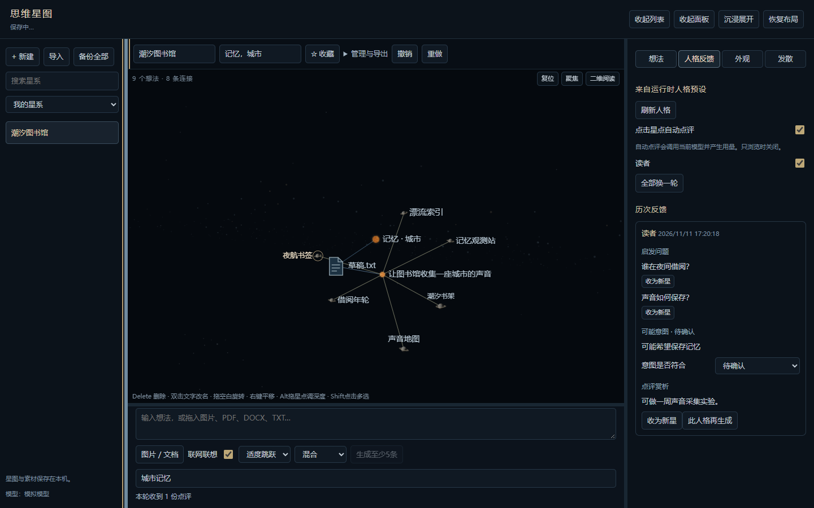

# 思维星图 · Idea Asterism

思维星图是 DeepSeek Harness（DSH）的三维思维风暴插件。围绕一至三个主题建立星系，把想法、图片和文档放进星图，再沿着某颗星继续联想。飞过星图的彗星会带来跨领域的提问，喜欢的可以留下。

Idea Asterism is a 3D brainstorming plugin for DeepSeek Harness. Map ideas and source materials, explore associations, and revisit a thought from different persona perspectives. Each star’s appearance, motion, and connections can be customized.



## 安装 1.0.0

下载发布附件 `dsh-idea-asterism-1.0.0.tgz`。在 Windows PowerShell 中，将下面两处路径改为 DSH 安装目录和下载文件的实际路径，然后执行：

```powershell
$dshDir = 'C:\Apps\DeepSeekH'
$package = 'C:\Downloads\dsh-idea-asterism-1.0.0.tgz'
& (Join-Path $dshDir 'resources\runtime\cli\bin\dsh.cmd') plugin --profile desktop add $package --offline --ignore-scripts
```

重启 DSH，从左侧栏打开「思维星图」。桌面集成已在 Windows、DSH `0.2.2-rc.1` 上验证。`0.2.1-rc.5` 仅验证过侧栏接入。从旧包 `dsh-star-sea` 切换时，先点「备份全部」，在 DSH 插件管理中移除旧包，再安装 `dsh-idea-asterism`。新版读取相同的数据目录，两个包同时启用会出现重复入口。

## 从第一颗星开始

1. 点击「+ 新建」，为星系命名并填写一至三个主题词。
2. 在底部输入文字，点「独立新想法」。它默认显示为恒星，也可以在输入区选择「纯文本」。导入一张图片或一份文档后，缩略图或文档图标会直接出现在图上。
3. 点「生成至少5条」可以从输入发散，选中已有星点后点「继续联想」可以向外延伸。成功的一轮会生成 5–8 条去重联想。打开「联网联想」可按确认的查询词搜索，并在结果中查看来源。
4. 拖动空白处旋转、右键拖动平移、滚轮缩放。双击文字改名，拖动节点移动，按 Alt 拖动调整深度。「想法 → 连接到」可手动连线。选中后按 Delete 会先确认，撤销可以恢复。
5. 在「人格反馈」中查看运行中的人格预设给出的提问、意图解读和赏析。在「发散」中点「投放一颗本地彗星」，可立即体验跨领域提示。鼠标靠近时彗星会减速，选中后可将它永久保留。

## 素材、模型与备份

文字、图片、PDF、DOCX 和文本类素材在本机解析，每份文件上限 8 MB。联想、人格点评和自动发散使用 DSH 配置的模型，可能消耗额度。点击星点的自动点评可在「人格反馈」关闭。联网搜索默认关闭，本地彗星无需模型。

人格名单由安装者自己的 DSH 在本机提供。刷新名单时，界面只收到人格标识、显示名及提示词的版本摘要。发起点评时，每个勾选的人格分别调用一次当前模型，请求包含该人格的提示词、星系主题、想法及关联素材、已有来源和该人格最近两次点评。新星系默认开启点击自动点评。使用云模型时，这些内容会发送给所配置的服务商，即使「联网联想」已关闭。

在「管理与导出」中可将单个星系导出为 JSON、ZIP、Markdown、PNG 或 PDF。迁移整个工作区时，在旧工作区点「备份全部」，再在新工作区点「导入」。全库备份含素材原文、所有星系、反馈、外观和视角，请按原始素材的保密要求保存。

完整功能与版本说明见 [更新日志](CHANGELOG.md)。构建、测试和宿主适配见 [开发说明](DEVELOPMENT.md)。随附第三方组件的许可文本位于 [assets](assets/)。

## 许可证

本项目采用 [MIT License](LICENSE)，版权所有者为 Adol-Elysium。随附第三方组件各自的许可文本位于 assets 目录。
